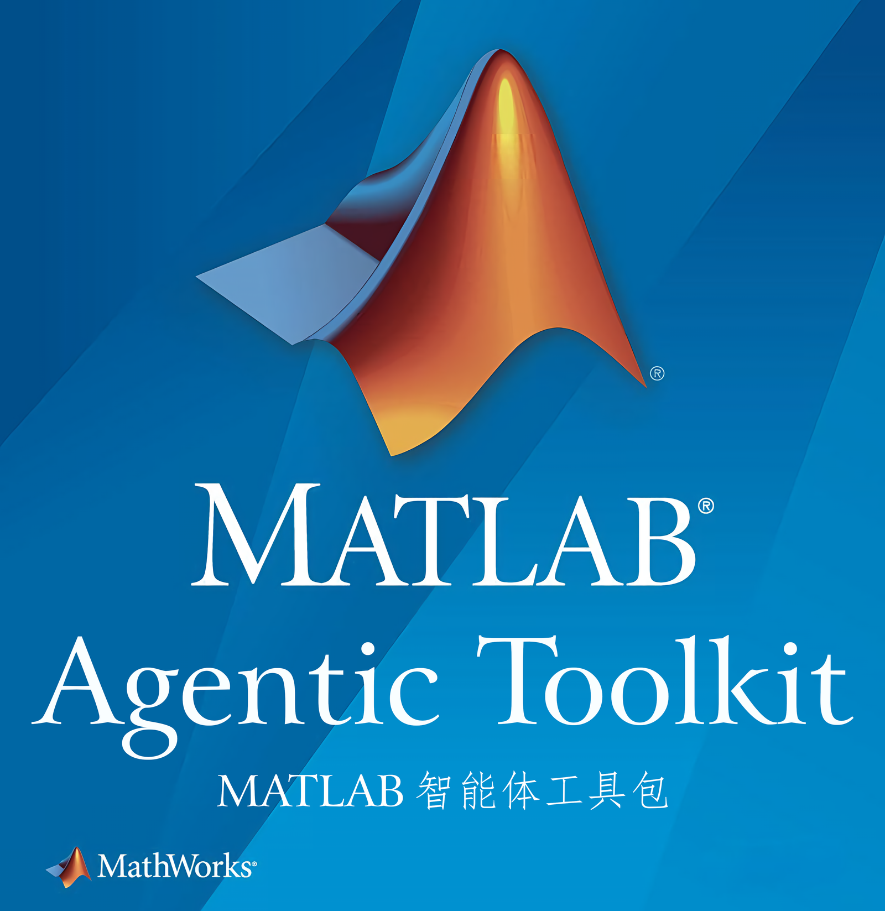

# Give your AI real MATLAB, at last

From a one-line request to writing code, running verification, analyzing data, and plotting, make MATLAB the workbench your AI assistant can reach at any time.

## Why choose it?

**The only plugin in the current DSH plugin market that brings in both MathWorks' official MATLAB skills and the MATLAB MCP Server.** The skills give your AI professional working methods, and the MCP server lets it run code, check problems, and execute tests in a local MATLAB — a complete path from idea to result.

- **Official skills, professional edge**: covering signal processing, radar, image processing, AI, optimization, and more, so your AI picks up MATLAB workflows and best practices.
- **Enable skills as needed**: pick groups on the settings page and keep only the skills relevant to your work, cutting context usage and keeping skill selection focused. This also follows [MathWorks' official recommendation](https://github.com/matlab/matlab-agentic-toolkit#run-matlab-workflows-using-agent-skills) for how agents should work.
- **Less setup, sooner results**: discover your local MATLAB automatically, download the official MCP Server and skills on first enable, and update dependencies from the settings page.

## Already installed? Three steps to start

1. **Prepare MATLAB**: the machine needs a working MATLAB R2021a or later, plus the toolboxes your tasks require.
2. **Open Settings → MATLAB**: wait for the first dependency download to finish and confirm the connection state; if MATLAB isn't found, point it at the install directory manually.
3. **Choose skill groups and save**: all groups are on by default; trim them to what your work needs. The core group is required. Then just ask for what you need in a conversation.

Try saying to your AI:

> Check the local MATLAB version and installed toolboxes, then generate a noisy sine signal, run a spectral analysis and plot it, and explain the results to me.

**Now hand it your MATLAB task.**

[Full guide and FAQ](https://github.com/tedcriss/dsh-matlab#readme) · [Report an issue](https://github.com/tedcriss/dsh-matlab/issues)
