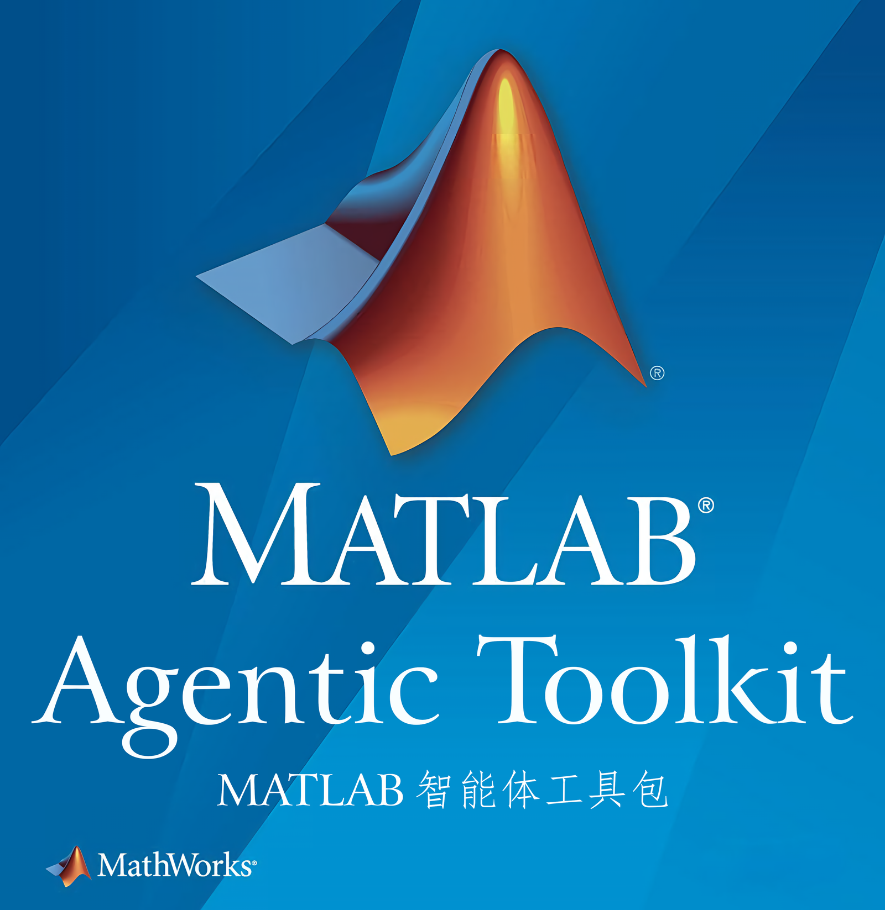

# 让你的 AI，真正用上 MATLAB

从一句需求，到编写代码、运行验证、分析数据和绘图，让 MATLAB 成为你的 AI 助手随时可用的工作台。

## 为什么选它？

**当前 DSH 插件市场中，唯一同时接入 MathWorks 官方 MATLAB 技能包与 MATLAB MCP Server 的插件。** 技能包提供专业工作方法，MCP 服务器让 AI 能在本机 MATLAB 中运行代码、检查问题、执行测试，形成从思路到结果的完整流程。

- **官方技能，专业加持**：覆盖信号处理、雷达、图像、AI、优化等领域，帮助 AI 掌握 MATLAB 的工作流程与最佳实践。
- **技能按需开启**：在设置页按组选择，只保留与你的工作相关的技能，减少上下文占用，让技能选择更聚焦。这也符合 [MathWorks 官方建议](https://github.com/matlab/matlab-agentic-toolkit#run-matlab-workflows-using-agent-skills) 的 Agent 使用方式。
- **少些配置，尽快开工**：自动发现本机 MATLAB，首次启用自动下载官方 MCP Server 与技能包；依赖更新也能在设置页完成。

## 已安装？三步开始

1. **准备 MATLAB**：本机需已安装并可正常使用 MATLAB R2021a 或更新版本，以及任务所需的工具箱。
2. **打开“设置 → MATLAB”**：等待首次依赖下载完成并确认连接状态；若未找到 MATLAB，可手动指定安装目录。
3. **选择技能组并保存**：默认全部开启，建议按工作需要精简；基础技能组为必需项。随后直接在对话中提出需求。

试着对 AI 说：

> 检查本机 MATLAB 版本和已安装的工具箱，然后生成一段含噪正弦信号，运行频谱分析并绘图，向我解释结果。

**现在，把你手头的 MATLAB 任务交给它。**

[完整说明与常见问题](https://github.com/tedcriss/dsh-matlab#readme) · [反馈问题](https://github.com/tedcriss/dsh-matlab/issues)
